# Таърихи саноати Тоҷикистон · История промышленности Таджикистана · History of Tajikistan's Industry

**Интерактивный киоск Музея развития промышленности Таджикистана** — история промышленности республики с 1924 по 2026 год: предприятия, продукция и экспортные рынки. Хроника из 257 событий в 8 периодах, 11 отраслей, 38 историй предприятий, карта промышленности, статистика и экспорт — от первых хлопкоочистительных заводов 1920-х до предприятий, открытых в октябре 2026 года.

**Муаллиф ва таҳиягар · Автор и разработчик · Author and developer: Сайдалиев Алиакбар (Saidaliev Aliakbar)**
© 2026. Ҳамаи ҳуқуқҳо ҳифз шудаанд · Все права защищены · All rights reserved

Маводро гирд овард · Материалы собрал · Content compiled by: Саидрахмонзода С.С.

### ▶ [Открыть киоск · Барномаро кушоед](https://grounsr.github.io/museum/?kiosk)

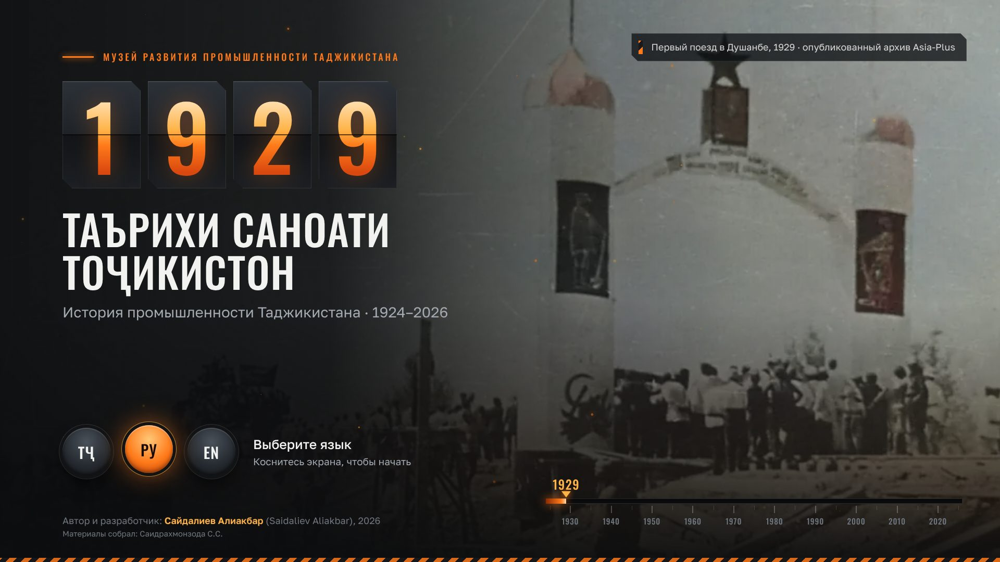

## Как открыть во весь экран

Браузеры разрешают полноэкранный режим только после действия посетителя, поэтому:

- **Первое касание экрана** разворачивает киоск во весь экран — и по ссылке, и из файла.
- **Ссылка для музея:** `https://grounsr.github.io/museum/?kiosk` — если полный экран случайно закрыли, он вернётся при следующем касании.
- **Как приложение:** на Android откройте ссылку в Chrome → меню ⋮ → «Установить приложение». Значок «Саноат» запускает киоск во весь экран, а после первого открытия он работает и без интернета.
- **Киоск-браузер:** в Fully Kiosk Browser укажите ссылку стартовой страницей и включите полноэкранный режим. На Windows: `chrome.exe --kiosk "https://grounsr.github.io/museum/?kiosk"`.

## Заставка

На заставке сменяются архивные и современные фотографии — от первого поезда в Душанбе (1929) до солнечных станций Памира (2026). Год снимка показан на механическом табло: цифры перекидываются, как на старом вокзальном табло, а внизу шкала 1924–2026 «наливается» раскалённым металлом до этого года. Подписи показываются по очереди на таджикском, русском и английском, круглая кнопка этого языка (ТҶ / РУ / EN) загорается оранжевым. Касание открывает киоск; круглые кнопки сразу выбирают язык.

---

## Разделы · Бахшҳо · Sections

| | Тоҷикӣ | Русский | English |
|---|---|---|---|
| 1 | **Таърихи саноат** — 8 давра, 257 рӯйдод: акс, рақам, ҷадвал ва манбаъ | **Хроника промышленности** — 8 периодов, 257 событий: фото, цифры, таблицы и источники | **Industrial chronicle** — 8 periods, 257 events with photos, figures, tables and sources |
| 2 | **Соҳаҳо ва маҳсулот** — 11 соҳа ва рӯйдодҳои ҳар кадом | **Отрасли и продукция** — 11 отраслей и их события | **Sectors and products** — 11 sectors and their events |
| 3 | **Таърихи корхонаҳо** — 38 корхона: номҳо ва марҳилаҳо (масалан, «Трактородеталь» → «Ҳумо») | **Истории предприятий** — 38 предприятий: названия и этапы (например, «Трактородеталь» → «Хумо») | **Company histories** — 38 enterprises, their names and stages (e.g. Traktorodetal → Humo) |
| 4 | **Харитаи саноат** — 40 маҳал, филтр аз рӯи давра ва соҳа | **Карта промышленности** — 40 мест, фильтр по периоду и отрасли | **Industrial map** — 40 places, filters by period and sector |
| 5 | **Саноат дар рақамҳо** — истеҳсол, кормандон, маҳсулот, энергетика, содирот | **Промышленность в цифрах** — выпуск, кадры, продукция, энергетика, экспорт | **Industry in numbers** — output, workforce, products, energy, exports |
| 6 | **Содирот ва бозорҳо** — харитаи ҷаҳон: аз 1968 то 2026 | **Экспорт и рынки** — карта мира: с 1968 по 2026 год | **Exports and markets** — world map, 1968–2026 |

| | |
|---|---|
| 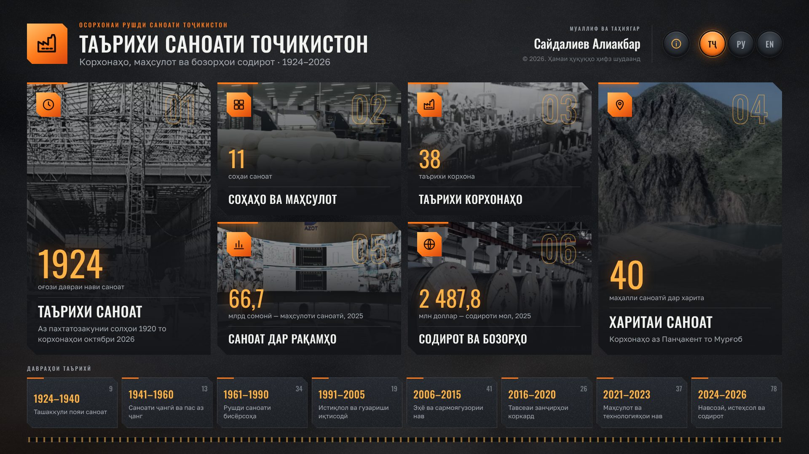 | 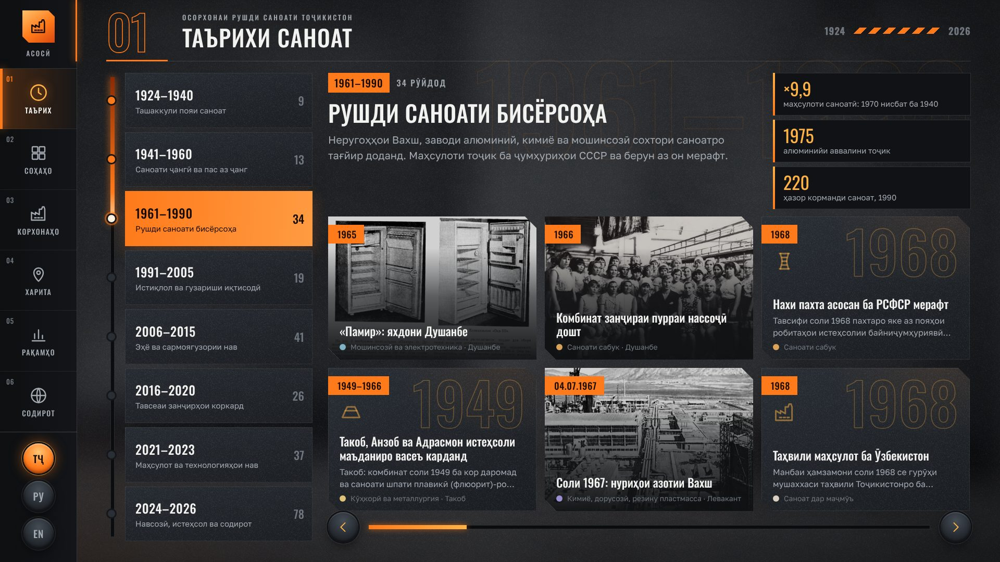 |
| 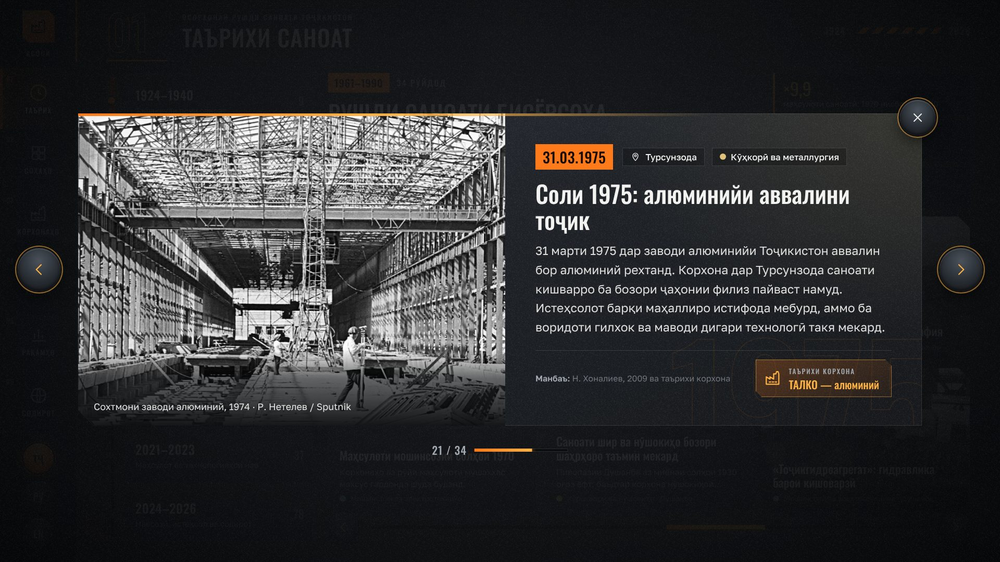 | 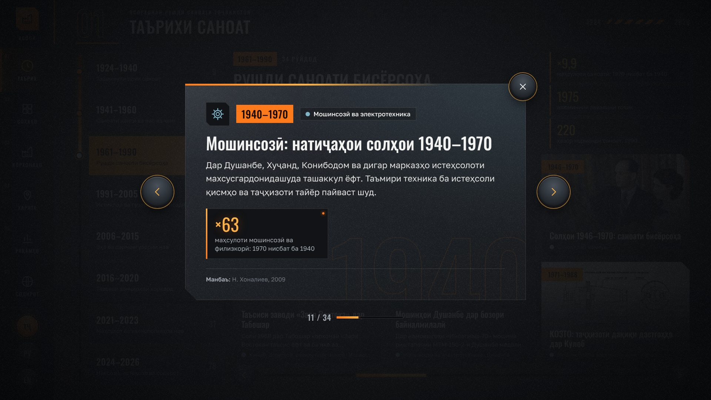 |
| 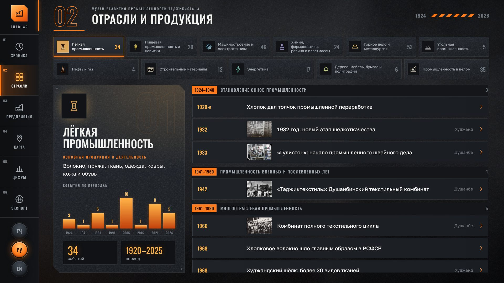 | 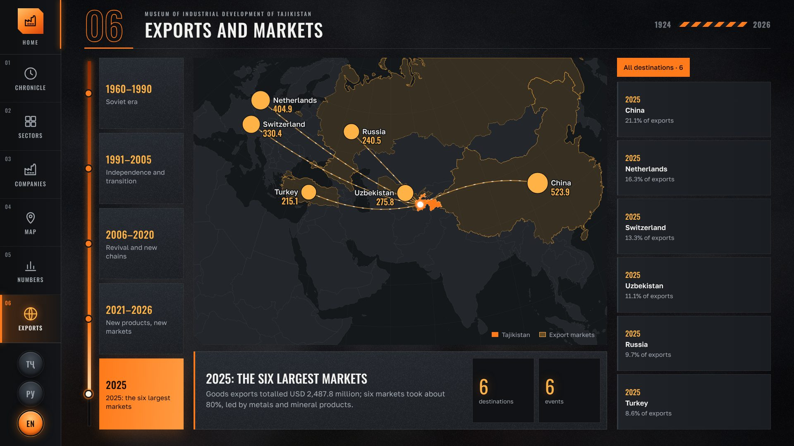 |
| 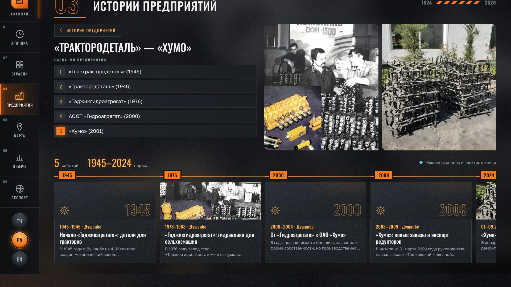 | 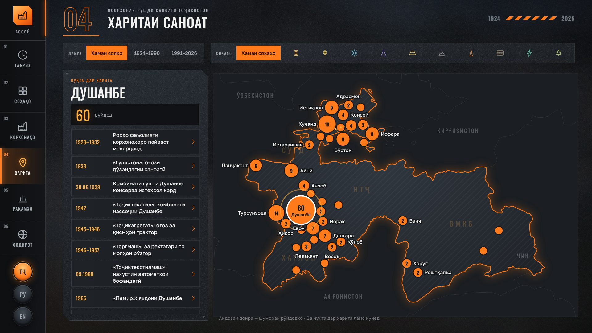 |
| 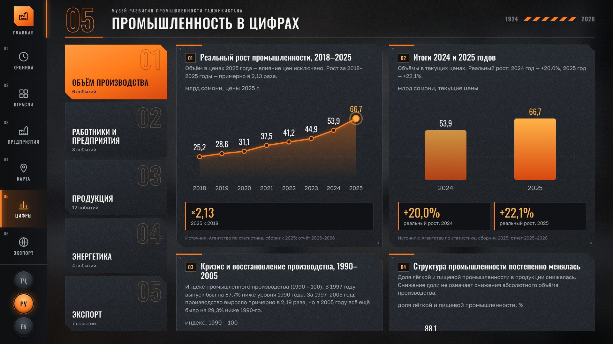 | 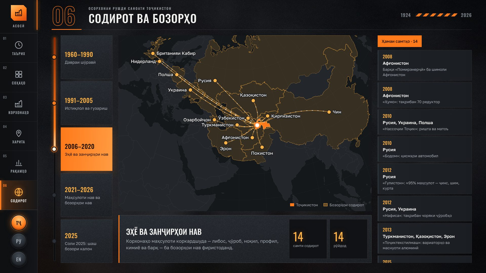 |

## Особенности

- Три языка: таджикский (по умолчанию), русский и английский. Переключаются круглыми кнопками ТҶ / РУ / EN на любом экране.
- Индустриальное оформление: графит и сталь, акцент «раскалённого металла», панели со скошенными углами и заклёпками, фон — фактура литого металла с мягким светом «плавильной печи» и размытой фотографией текущего раздела, предупредительные полосы, крупные номера разделов-«цехов»; шрифты Oswald и Golos Text встроены и поддерживают таджикские буквы (ғ, ӣ, қ, ӯ, ҳ, ҷ).
- Слева на всех экранах — панель управления: «Главная», шесть разделов с номерами 01–06 и кнопки языка. Переходить между разделами можно без возврата на главную.
- Главная — мозаика из шести разделов разного размера и «конвейер» из восьми исторических периодов.
- Окно события подстраивается под содержание: если данных мало — компактное информационное окошко; если есть фотография — снимок на всю высоту окна (несколько снимков сменяются сами); для графиков — широкое окно. Пустых мест нет.
- 3D-переходы: окно «вылетает» из нажатой карточки, соседние события перелистываются с поворотом в пространстве, окно можно тянуть пальцем. Экраны сменяются с 3D-наклоном и световой волной.
- Живая анимация: слова заголовков появляются по одному, цифры «набегают» от нуля, столбцы графиков растут, линии рисуются, маршруты экспорта прочерчиваются по карте, точки на карте всплывают; большие контурные годы плавно парят на фоне; плитки главной наклоняются под пальцем и «дышат».
- Из окна события можно перейти к истории предприятия; на странице предприятия — галерея его фотографий.
- Карты нарисованы заранее (Natural Earth): Таджикистан с соседями и подписями регионов, карта мира с маршрутами экспорта.
- Работает без интернета: один файл `index.html` (≈9 МБ) со шрифтами, 105 фотографиями и картами.
- Сенсорный экран 32″, 1920×1080 и 4K: интерфейс масштабируется автоматически.
- Режим киоска: заставка, автовозврат к заставке через 2 минуты без касаний (за 15 секунд — предупреждение), защита от случайного выхода и масштабирования.
- Честная подача цифр: везде, где источник различает проектную мощность и фактический выпуск, соглашение и запуск, это сказано на экране.

## Источники данных

Презентация «Таърихи саноати Тоҷикистон 1924–2026. Таърихи корхонаҳо, маҳсулот ва бозорҳои содирот» (272 слайда; материалы собрал Саидрахмонзода С.С.). Основные источники внутри неё:

- Н. Хоналиев, 2009 — исторические ряды 1940–2005.
- Агентство по статистике при Президенте РТ — сборник «Промышленность Республики Таджикистан», 2025; годовые итоги 2024–2025; таблицы промышленной продукции 1985–2025; экспорт 1993–2025.
- Госкомстат СССР, 1991; справочник «Таджикистан», 1968; Большая советская энциклопедия.
- Послания Президента РТ (2011, 2015, 2021, 2025); пресс-служба и архив сайта Президента; НИАТ «Ховар».
- Отчёты ИПДО (EITI) 2015–2016; Всемирный банк; Азиатский банк развития (10.04.2026).
- Официальные материалы предприятий, Asia-Plus, «Народная газета» и другие издания — источник указан под каждой цифрой.

Количественная статистика — по итогам 2025 года; события 2026 года — качественная хроника по 30.10.2026.

## Авторское право

Программа собрана в один минифицированный файл; исходные файлы, данные и скрипты сборки не публикуются. Разрешены только просмотр опубликованной страницы и демонстрация в экспозиции. Копирование, изменение, восстановление исходного кода и использование в других проектах без письменного разрешения автора запрещены — см. [LICENSE](LICENSE).

Если файл запустить с чужого сайта, поверх экрана появится надпись «Несанкционированная копия» с именем автора и идентификатором сборки. В каждую фотографию встроена метка сборки киоска (EXIF). Права на сами фотографии принадлежат их авторам и источникам, указанным в киоске.

По правилам GitHub публичный репозиторий можно просматривать и форкать внутри GitHub; это не даёт права использовать программу где-либо ещё.

Шрифты Oswald и Golos Text (SIL OFL 1.1) и контуры карт Natural Earth — см. [THIRD_PARTY_NOTICES.md](THIRD_PARTY_NOTICES.md).

Идентификатор сборки · Build ID: `SA-IN-2026-AE7713-F6312F`

**© 2026 Сайдалиев Алиакбар (Saidaliev Aliakbar). All rights reserved.**
