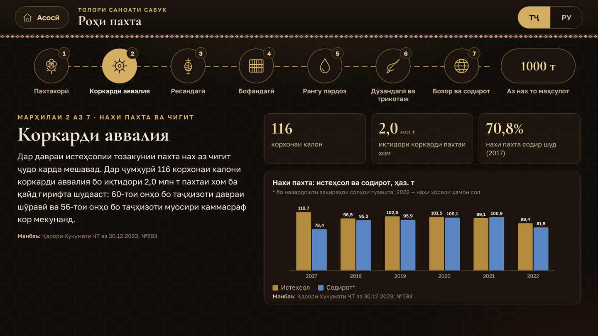
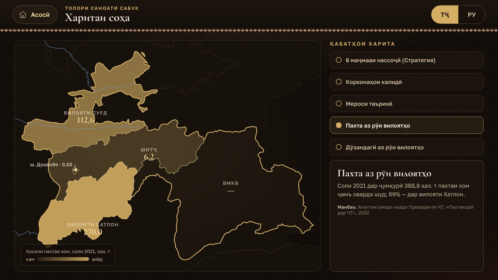
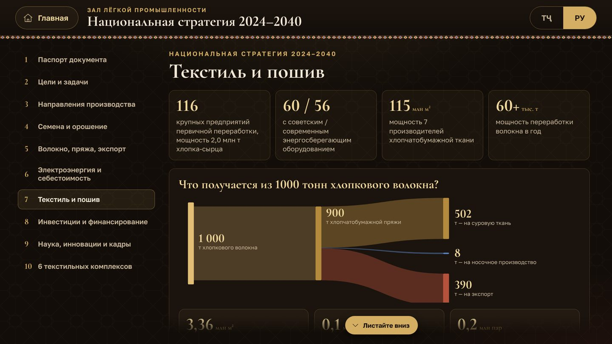

# Нассоҷии Тоҷикистон · Текстиль Таджикистана

**Интерактивный киоск зала лёгкой промышленности** — история текстиля, лёгкая промышленность Таджикистана сегодня и Национальная стратегия развития производства, переработки хлопка и текстильной промышленности на 2024–2040 годы (постановление Правительства РТ №593 от 30.12.2023).

**Муаллиф ва таҳиягар · Автор и разработчик: Сайдалиев Алиакбар**
© 2026. Ҳамаи ҳуқуқҳо ҳифз шудаанд · Все права защищены

### ▶ [Открыть киоск · Барномаро кушоед](https://grounsr.github.io/museum/)

---

## Разделы · Бахшҳо

| | Тоҷикӣ | Русский |
|---|---|---|
| 1 | **Таърихи нассоҷӣ** — аз Саразм ва Суғд то мероси ЮНЕСКО | **История текстиля** — от Саразма и Согда до наследия ЮНЕСКО |
| 2 | **Роҳи пахта** — 7 марҳила ва «аз 1000 т нах чӣ ҳосил мешавад» | **Путь хлопка** — 7 этапов и «что получается из 1000 т волокна» |
| 3 | **Саноати сабук имрӯз** — нишондиҳандаҳо, корхонаҳо, содирот | **Лёгкая промышленность сегодня** — показатели, предприятия, экспорт |
| 4 | **Харитаи соҳа** — 6 маҷмааи нассоҷӣ, корхонаҳо, минтақаҳо | **Карта отрасли** — 6 текстильных комплексов, предприятия, регионы |
| 5 | **Стратегияи миллӣ 2024–2040** — ҳамаи рақамҳо ва бахшҳо | **Национальная стратегия 2024–2040** — все цифры и разделы |
| 6 | **Нақшаи амал 2024–2026** — 23 чорабинӣ | **План действий 2024–2026** — 23 мероприятия |

| | |
|---|---|
|  |  |
|  |  |

## Особенности

- Два языка: таджикский (по умолчанию) и русский.
- Работает без интернета — один файл `index.html`.
- Сенсорный экран 32″, 1920×1080 и 4K: интерфейс масштабируется автоматически.
- Режим киоска: заставка, автовозврат к началу через 2 минуты без касаний, защита от случайного выхода.
- Источник каждой цифры указан на экране.

## Авторское право

Код программы защищён и зашифрован. Разрешён только просмотр опубликованной страницы и демонстрация в экспозиции. Копирование, изменение, вскрытие защиты и использование в других проектах без письменного разрешения автора запрещены — см. [LICENSE](LICENSE).

По правилам GitHub публичный репозиторий можно просматривать и форкать внутри GitHub; это не даёт права использовать программу где-либо ещё.

**© 2026 Сайдалиев Алиакбар (Saidaliev Aliakbar). All rights reserved.**
